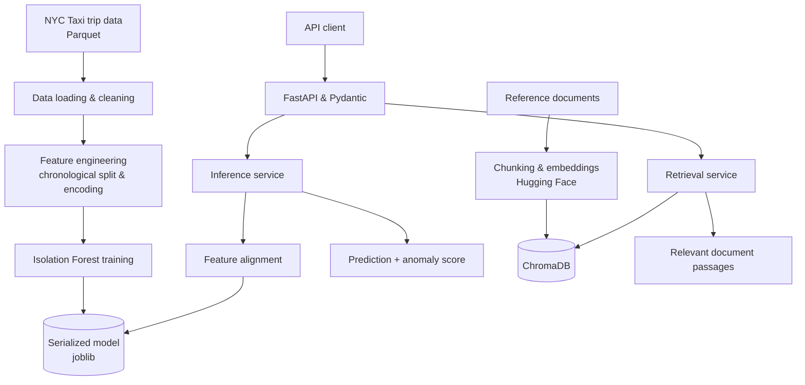

# FareAudit AI

**Anomaly detection for NYC taxi fares, with a document-retrieval layer for contextual investigation.**

FareAudit AI is an end-to-end ML engineering project built around a practical question: **which taxi trips deserve a closer look, and how can an analyst investigate them efficiently?** It combines a data-processing and unsupervised-learning pipeline, a REST API for inference, and semantic retrieval over supporting documents.

The project emphasizes **clear component boundaries, consistent training/inference features, testable behavior, and a path toward automated delivery**. It is an engineering prototype, not a production fraud-detection system.

**Stack:** Python 3.11 · PyArrow · Pandas · NumPy · scikit-learn · FastAPI · Pydantic · LangChain · Hugging Face · ChromaDB · pytest · Docker · GitHub Actions

> **Project status — active development (November 2026).** Model training, inference, document retrieval, a Docker image, and automated pytest checks are in place. Automated image publishing, deployment, and LLM-based answer generation are planned or being developed; they should not be considered live features yet.

## The problem


Taxi trip records contain combinations of distance, fare, tip, total charge, payment method, and pickup time that may be unusual. Handwritten thresholds are useful, but they cannot capture every atypical combination of features.

FareAudit AI uses an **Isolation Forest** to flag statistically unusual trips for review. A separate **retrieval component** helps surface relevant documentation, rather than treating an anomaly score as an explanation on its own.

**A detected anomaly is not evidence of fraud.** The model identifies observations worth investigating; it does not establish intent, wrongdoing, or a validated fraud probability.

## What the project does

| Component | Responsibility | Status |
| --- | --- | --- |
| Data pipeline | Read Parquet data, clean records, and prepare ML features | Implemented |
| Anomaly detection | Train and serialize an Isolation Forest model | Implemented |
| Inference | Rebuild model-compatible features and return a structured prediction | Implemented |
| REST API | Validate requests and expose application functionality via FastAPI | Implemented |
| Document retrieval | Embed documents and retrieve relevant passages with ChromaDB | Implemented |
| Quality checks | Run automated Python tests with pytest and GitHub Actions | Implemented; coverage expanding |
| Containerization | Build a Docker image for the API | Built locally |
| Automated delivery | Publish versioned images and deploy the service | In progress |
| LLM answer generation | Generate grounded answers from retrieved documents | Planned |

## System architecture



The **prediction path** and the **retrieval path** are deliberately separated. This keeps ML inference independent from document search and makes both components easier to test and evolve.

## Data and modeling

The initial experiment uses **NYC TLC Yellow Taxi trip data (January 2025)**, stored as Parquet. PyArrow supports sampling from a larger source file without loading the entire dataset into memory.

The training workflow covers data preparation, chronological splitting, categorical encoding of `payment_type`, model fitting, and serialization of the inference artifact to `models/isolation_forest.joblib`.

### Initial experiment snapshot

| Measure | Observed value |
| --- | ---: |
| Trips sampled | 100,000 |
| Records retained after cleaning | 99,999 |
| Training rows | 79,999 |
| Test rows | 20,000 |
| Model features | 10 |
| Test trips flagged as anomalous | 369 |
| Share flagged in that test set | 1.845% |

These values describe an **exploratory experiment**, not a fraud-detection accuracy benchmark. The configured contamination level sets an anomaly threshold during fitting; it does **not** imply a known proportion of fraudulent trips. Without reliable ground-truth labels, precision, recall, and fraud-detection accuracy cannot be claimed.

### Inference contract

Requests are validated with **Pydantic**. A trip includes the following fields:

```json
{
  "trip_distance": 12.5,
  "fare_amount": 45,
  "tip_amount": 5,
  "total_amount": 55,
  "pickup_hour": 14,
  "payment_type": 1
}
```

The inference layer aligns inputs with the **feature names and order expected by the trained model**, including one-hot encoded payment types. The response has this shape:

```json
{
  "prediction": -1,
  "is_anomaly": true,
  "anomaly_score": -0.08
}
```

*The response above is illustrative, not an actual prediction for the example trip.* In scikit-learn's Isolation Forest, `prediction` is **`-1` for an outlier** and **`1` for an inlier**. The `anomaly_score` is the model's decision-function output, **not a calibrated probability**; negative values fall on the anomalous side of the decision threshold.

## Document retrieval (RAG foundation)

The retrieval subsystem is designed to support investigations with relevant reference material:

1. Load and split reference documents into manageable passages.
2. Generate multilingual embeddings using a Hugging Face sentence-transformer model.
3. Persist vectors in **ChromaDB**.
4. Retrieve relevant passages with LangChain for a user question.

The current scope is **retrieval**. Connecting an LLM to produce grounded, source-aware answers is a future extension; retrieved text alone should not be presented as an LLM-generated explanation.

## Project layout

```text
FareAudit-ai/
├── .github/workflows/       # Automated CI workflows
├── data/                    # Local datasets (not necessarily tracked)
├── knowledge/               # Reference documents for retrieval
├── chroma_db/               # Local vector-store persistence
├── models/                  # Trained model artifacts
├── src/fareaudit/           # Application and ML modules
│   ├── schemas.py           # Pydantic input/output contracts
│   └── inference.py         # Model inference logic
├── tests/                   # Automated tests
├── main.py                  # FastAPI application entry point
├── train_model.py           # Model training entry point
├── requirements.txt         # Python dependencies
├── Dockerfile               # Container build instructions
└── .dockerignore            # Docker build-context exclusions
```

Only representative modules are shown under `src/fareaudit/`; consult the repository for the full package structure.

## Getting started

### Prerequisites

- Python **3.11**
- `pip` and `venv`
- The required local data/model artifacts for the workflow you intend to run
- Docker (optional, for containerized execution)

### Install

```bash
# From the repository root
python3.11 -m venv .venv
source .venv/bin/activate
python -m pip install --upgrade pip
python -m pip install -r requirements.txt
```

### Train the model

Place the source Parquet file at the configured dataset path (the initial workflow uses `data/raw/yellow_tripdata_2025-01.parquet`) and run:

```bash
python train_model.py
```

The trained artifact is expected at `models/isolation_forest.joblib`. Large datasets and serialized models are typically managed outside Git; ensure they are available before running inference.

### Run the API locally

```bash
uvicorn main:app --host 127.0.0.1 --port 8000 --reload
```

Open **http://127.0.0.1:8000/docs** for the interactive OpenAPI documentation and the currently implemented routes. This documentation is the source of truth for endpoint paths and request schemas as the API evolves.

### Build and run with Docker

```bash
docker build -t fareaudit:1.0 .

docker run --rm --name fareaudit-api \
  -p 127.0.0.1:8000:8000 \
  fareaudit:1.0
```

The Docker image was built successfully in the local development environment. **A successful image build does not, by itself, verify API startup or inference.** If your `.dockerignore` excludes model artifacts or the vector database, provide them at runtime through appropriate mounts or initialize them separately.

## Tests and continuous integration

The test suite uses **pytest**, including **mocking and monkeypatching** to isolate inference behavior from model loading and feature preparation.

```bash
python -m pytest tests/ -v
```

The workflow at `.github/workflows/ci.yml` runs tests automatically on GitHub Actions. It provides a clean environment to catch regressions that could otherwise be hidden by a developer's local setup.

Current test work focuses on:

- Pydantic input validation and invalid numerical values.
- Inference output contracts for both normal and anomalous predictions.
- Feature preprocessing and alignment with trained-model columns.
- API response and error-path coverage.

**CI is operational; test coverage is still being expanded.** Publishing Docker images to GHCR and deploying them to a target environment are separate delivery steps and are not claimed as complete here.

## Engineering decisions and trade-offs

| Decision | Rationale / limitation |
| --- | --- |
| Isolation Forest | Unsupervised approach suitable for anomaly triage when trustworthy fraud labels are unavailable; output is not a fraud verdict. |
| Chronological train/test split | Evaluates on later observations and reduces temporal leakage compared with arbitrary mixing. |
| One-hot encoding and feature alignment | Keeps inference inputs compatible with the representation used during training. |
| Pydantic schemas | Defines a clear input contract and rejects invalid requests before inference. |
| Separated prediction and retrieval components | Supports independent testing, debugging, and future evolution. |
| Docker | Packages application code and dependencies; runtime model and data artifacts still need explicit management. |
| GitHub Actions + pytest | Provides repeatable, automated checks before further delivery stages. |

## Roadmap

- [x] Implement an initial Parquet-to-Isolation-Forest pipeline.
- [x] Expose model inference through a FastAPI application.
- [x] Implement semantic document retrieval using embeddings and ChromaDB.
- [x] Containerize the API and validate the image build locally.
- [x] Run automated tests with GitHub Actions.
- [ ] Expand unit and API integration tests; measure coverage.
- [ ] Pin dependencies and introduce model/data artifact versioning.
- [ ] Add Docker build and GHCR publication after successful CI checks.
- [ ] Deploy to a selected environment with health checks and rollback strategy.
- [ ] Add LLM-based, citation-grounded investigation responses and evaluate them.
- [ ] Add operational monitoring and drift-aware evaluation.

## Scope and limitations

This is a **learning and engineering prototype**. It currently demonstrates anomaly identification and contextual document retrieval, but it does not provide verified fraud labels, calibrated fraud probabilities, production monitoring, or a deployed LLM assistant. Predictions should be used to **prioritize human review**, not as automated adverse decisions.

---

**FareAudit AI** · Python · Machine Learning · Retrieval · API Engineering · MLOps
