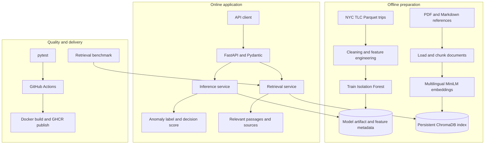
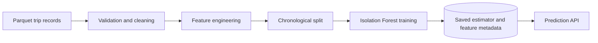
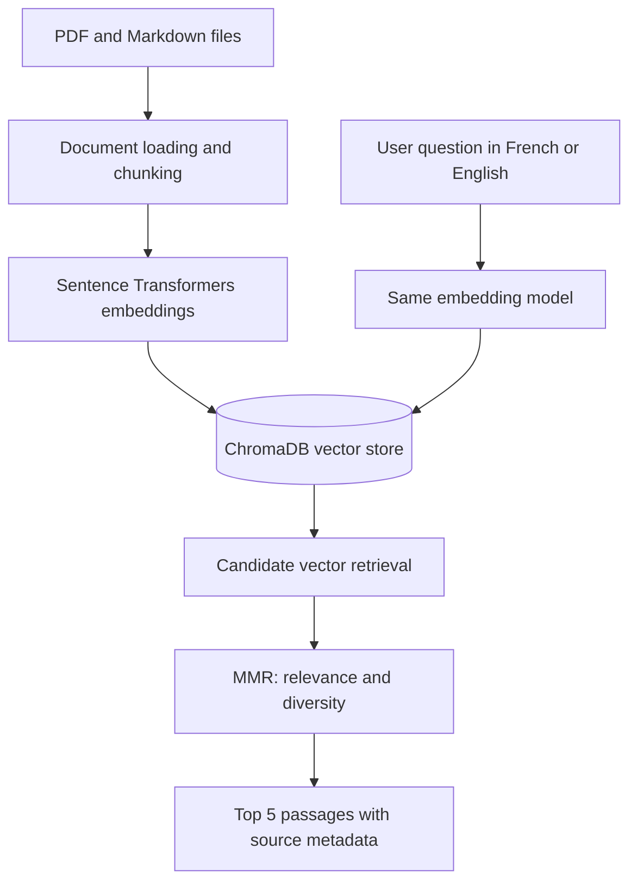
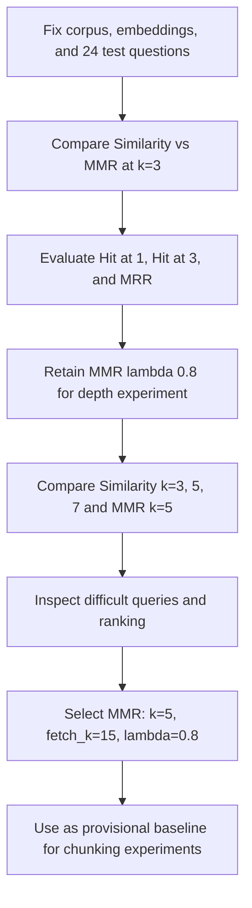
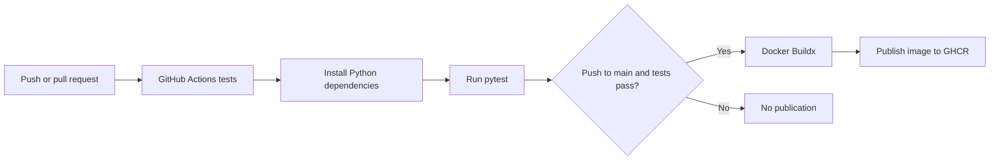

# FareAudit AI

**Anomaly detection and evidence-based investigation for New York City taxi trips.**

FareAudit AI is an end-to-end machine learning engineering project that detects statistically unusual taxi fares and retrieves relevant reference material to support an investigation. It combines a reproducible data pipeline, unsupervised anomaly detection, an inference API, multilingual semantic retrieval, evaluation experiments, and containerized delivery.

> **Current status:** Anomaly detection, API serving, document indexing, and passage retrieval are implemented. **LLM-based answer generation is planned and is not presented as an existing feature.**

**Stack:** Python 3.11 · Pandas · NumPy · PyArrow · scikit-learn · FastAPI · Pydantic · LangChain · Sentence Transformers · ChromaDB · pytest · Docker · GitHub Actions · GitHub Container Registry (GHCR)

---

## Contents

1. [Problem and objectives](#problem-and-objectives)
2. [System architecture](#system-architecture)
3. [Data and anomaly detection](#data-and-anomaly-detection)
4. [Multilingual document retrieval](#multilingual-document-retrieval)
5. [Retrieval evaluation and parameter selection](#retrieval-evaluation-and-parameter-selection)
6. [API and application behavior](#api-and-application-behavior)
7. [Getting started](#getting-started)
8. [Testing and CI/CD](#testing-and-cicd)
9. [Repository structure](#repository-structure)
10. [Engineering decisions and limitations](#engineering-decisions-and-limitations)
11. [Roadmap](#roadmap)
12. [Data source](#data-source)

## Problem and objectives

Taxi fares depend on several interacting variables: trip distance, time, payment method, fare components, and surcharges. An unusual combination of these features may warrant additional investigation, but an anomaly score alone does not explain the domain-specific meaning of the fields involved.

FareAudit AI separates this problem into **two complementary services**:

- **Anomaly detection:** an Isolation Forest model flags statistically unusual trips and provides a decision score through a REST API.
- **Contextual retrieval:** a multilingual search pipeline retrieves relevant excerpts from NYC Taxi & Limousine Commission (TLC) documentation and project reference notes.

The design deliberately separates **prediction** from **document retrieval**. A negative anomaly score is **not** evidence of fraud and is **not** a calibrated fraud probability.

## System architecture



The ML pipeline and knowledge index are prepared independently. At runtime, the API can serve predictions and expose retrieved document passages without requiring LLM generation.

## Data and anomaly detection

### Dataset and feature pipeline

The recorded ML experiment uses **NYC TLC Yellow Taxi records for January 2025**, stored in Parquet format. PyArrow and Pandas support reading, cleaning, and feature engineering. Categorical inputs are encoded and aligned with the exact columns and order used during training.



### Recorded experiment snapshot

| Measure | Result |
|---|---:|
| Trips sampled | 100,000 |
| Records remaining after cleaning | 99,999 |
| Training records | 79,999 |
| Test records | 20,000 |
| Model input features | 10 |
| Test records flagged as anomalous | 369 |
| Fraction of test records flagged | 1.845% |

These are **descriptive results of one recorded experiment**, not fraud-detection precision or recall: no verified fraud labels are used to establish those metrics.

### Prediction semantics

In scikit-learn Isolation Forest, a prediction of `-1` denotes an outlier and `1` denotes an inlier. `decision_function` produces a decision score; values below zero fall on the anomalous side of the model threshold.

The serving pipeline reconstructs training-time features, including one-hot encoded inputs and their order, to reduce training/serving skew.

## Multilingual document retrieval

### Knowledge sources

The knowledge index includes official NYC TLC PDF documentation and project Markdown reference notes. Confirmed source files include:

| Source | Purpose |
|---|---|
| `yellow_taxi_data_dictionary.pdf` | Field definitions and numeric codes for Yellow Taxi records |
| `trip_record_user_guide.pdf` | Context on TLC trip records, zones, and datasets |
| `payment_types.md` | Payment codes and interpretation |
| `financial_fields.md` | Fare, tip, and total amount descriptions |
| `investigation_rules.md` | Experimental internal guidance; **not official TLC fraud policy** |

**Latest observed indexing run:** the loader reported **10 loaded document units** and **29 indexed chunks**. The load count is the ingestion script's reported count; it should not automatically be interpreted as ten distinct source filenames.

### Retrieval pipeline



**Embedding model:** `sentence-transformers/paraphrase-multilingual-MiniLM-L12-v2`, run locally on CPU with normalized embeddings. It supports cross-language queries, such as a question written in French retrieving evidence from an English PDF.

**Important:** changing an embedding model or chunking strategy requires rebuilding the index. Even embeddings with the same dimensions are not necessarily compatible across models.

### Why MMR?

A similarity search ranks passages by vector proximity to the question. **Maximal Marginal Relevance (MMR)** first considers a candidate pool and then selects passages while balancing relevance with diversity, reducing the likelihood of returning several near-duplicates.

A simplified selection objective is:

$$
\operatorname{MMR}(d) = \lambda\,\operatorname{sim}(q,d)
- (1-\lambda)\max_{s\in S}\operatorname{sim}(d,s)
$$

Here `q` is the question, `d` is a candidate passage, `S` is the already-selected set, and `lambda_mult` controls the relevance/diversity balance. The tested LangChain MMR implementation uses cosine similarity during this selection step.

**Selected experimental retriever configuration:**

```python
from src.fareaudit.vector_store import get_vector_store


def retriever():
    db = get_vector_store()
    return db.as_retriever(
        search_type="mmr",
        search_kwargs={
            "k": 5,
            "fetch_k": 15,
            "lambda_mult": 0.8,
        },
    )
```

- **`k=5`:** return five passages to the caller.
- **`fetch_k=15`:** form a candidate pool of up to fifteen passages for MMR selection. This parameter was **not independently optimized**.
- **`lambda_mult=0.8`:** favor relevance over diversity; selected after an earlier comparison against `0.5`.

## Retrieval evaluation and parameter selection

Instead of selecting retriever parameters by intuition, FareAudit AI uses a **repeatable 24-question benchmark** with French and English queries. The experiments use the same indexed corpus and embedding model while comparing search strategies and retrieval depth.

### Evaluation approach

For each question, the evaluator records an expected source filename and an expected answer fragment. A returned passage is automatically marked relevant only when **both** the source and normalized text fragment match. The script then computes:

- **Hit@1:** at least one accepted passage in the first result.
- **Hit@K:** at least one accepted passage among the first `K` results.
- **MRR:** mean reciprocal rank of the first accepted passage; a miss contributes zero.

This is a **rule-based passage-match benchmark**, not a complete human relevance assessment. Semantically correct alternative wording or another valid source may be marked as a miss.

### Experiment 1 — Similarity vs. MMR (`k=3`)

| Retrieval configuration | Hit@1 | Hit@3 | MRR |
|---|---:|---:|---:|
| Similarity, k=3 | 75.00% | 87.50% | 0.8056 |
| MMR, k=3, fetch_k=10, λ=0.5 | 75.00% | 79.17% | 0.7708 |
| **MMR, k=3, fetch_k=10, λ=0.8** | **75.00%** | **91.67%** | **0.8194** |

**Finding:** with the same three returned passages, `lambda_mult=0.8` achieved better observed Hit@3 and MRR than the other tested configurations. It was therefore retained for the next experiment. This is a within-benchmark result, not proof of global superiority.

### Experiment 2 — Retrieval depth (`k`)

| Retrieval configuration | Hit@1 | Hit@3 | Hit@5 | Hit@7 | MRR |
|---|---:|---:|---:|---:|---:|
| Similarity, k=3 | 75.00% | 87.50% | 87.50%* | 87.50%* | 0.8056 |
| Similarity, k=5 | 75.00% | 87.50% | 95.83% | 95.83%* | 0.8243 |
| Similarity, k=7 | 75.00% | 87.50% | 95.83% | 100.00% | 0.8313 |
| **MMR, k=5, fetch_k=15, λ=0.8** | **75.00%** | **91.67%** | **100.00%** | **100.00%*** | **0.8403** |

\* Values above the actual retrieval depth are carried forward from the results that were returned; they are **not independent searches at the larger depth**.

### Diagnostic questions

Three harder questions helped differentiate configurations:

| Question | Similarity k=5 | Similarity k=7 | MMR k=5 |
|---|---:|---:|---:|
| `PULocationID` definition | Rank 5 | Rank 5 | **Rank 4** |
| `DOLocationID` definition | Not retrieved | Rank 6 | **Rank 4** |
| Voided-trip payment code | Rank 4 | Rank 4 | **Rank 3** |

For this benchmark, **MMR with five returned passages recovered all 24 expected fragments**, whereas similarity at five returned passages recovered 23 of 24. Similarity needed seven returned passages to recover all 24.

### Parameter selection workflow



**Decision:** retain **MMR / `k=5` / `fetch_k=15` / `lambda_mult=0.8`** as the **current experimental baseline**, because it achieved the best recorded Hit@5 and MRR while returning fewer passages than Similarity k=7.

**Caveat:** `fetch_k=15` was held as a chosen setting during the depth comparison and has not been tested against alternative candidate-pool sizes. Parameter selection was conducted on the evaluation questions themselves; a held-out question set is needed before claiming generalization.

**Reproduce the retrieval evaluation:**

```bash
python evaluate_retriever.py
```

The evaluation invokes the real embedding model and persistent ChromaDB collection; it is an integration benchmark rather than a mocked unit test. Preserve the indexed corpus and question labels when comparing configurations.

## API and application behavior

### Input example

A representative prediction payload is:

```json
{
  "trip_distance": 12.5,
  "fare_amount": 45,
  "tip_amount": 5,
  "total_amount": 55,
  "pickup_hour": 14,
  "payment_type": 1
}
```

### Response shape

```json
{
  "prediction": -1,
  "is_anomaly": true,
  "anomaly_score": -0.08
}
```

These response values are **illustrative**, not the model's computed prediction for the sample request. Consult the interactive FastAPI documentation for the routes and required fields in your checked-out version:

```text
http://127.0.0.1:8000/docs
```

The retrieval capability currently returns relevant passages and source metadata. A grounded natural-language answer generator with citations is **future work**.

## Getting started

### Requirements

- Python 3.11 and `pip`
- A local virtual environment
- Project dependencies from `requirements.txt`
- Dataset and model artifacts for inference or training
- Network access on first download of the embedding model, unless it is already cached locally

### Setup

```bash
git clone <YOUR_REPOSITORY_URL>
cd FareAudit-ai
python3.11 -m venv .venv
source .venv/bin/activate
python -m pip install --upgrade pip
python -m pip install -r requirements.txt
```

Replace `<YOUR_REPOSITORY_URL>` with the actual repository URL.

### Train the anomaly detector

Place the January 2025 NYC TLC Yellow Taxi Parquet file at the path expected by your training script (recorded project path: `data/raw/yellow_tripdata_2025-01.parquet`). Then run:

```bash
python train_model.py
```

The trained estimator is expected at `models/isolation_forest.joblib`. Ensure the feature metadata and model files required by inference are present.

### Rebuild the knowledge index

```bash
python -m scripts.index_knowledge
```

**Index rebuild is destructive in the currently documented implementation:** it resets the existing ChromaDB collection and recreates its vectors. Back up any index you need to keep and avoid rebuilding while another process is using it. A clean rebuild is required after changing the embedding model or chunking parameters.

The latest recorded run reported:

```text
Documents chargés : 10
Chunks indexés : 29
```

### Start the API

```bash
uvicorn main:app --host 127.0.0.1 --port 8000 --reload
```

Open `http://127.0.0.1:8000/docs` to inspect and exercise the available endpoints.

### Evaluate retrieval

```bash
python evaluate_retriever.py
```

### Build a Docker image

```bash
docker build -t fareaudit:1.0 .
docker run --rm --name fareaudit-api \
  -p 127.0.0.1:8000:8000 \
  fareaudit:1.0
```

Make sure the Docker image or container mounts provide the model artifacts and ChromaDB index required for the runtime features you plan to use.

## Testing and CI/CD

Unit and contract tests use **pytest** for validation and inference behavior. Model-heavy dependencies can be mocked when testing individual units; retrieval benchmarking is intentionally separate and uses real local artifacts.

```bash
python -m pytest tests/ -v
```

### Delivery flow



The documented workflow publishes images to **GitHub Container Registry** on successful pushes to `main`, using `latest` and the commit SHA as tags. This is **image publication**, not an automatic deployment to an application environment.

## Repository structure

```text
FareAudit-ai/
├── .github/
│   └── workflows/
│       └── ci.yml
├── src/
│   └── fareaudit/
│       ├── document_loader.py    # Knowledge ingestion / chunking
│       ├── embeddings.py         # Multilingual embeddings
│       ├── vector_store.py       # ChromaDB access and indexing
│       ├── retriever.py          # Retrieval strategy and parameters
│       ├── inference.py          # Anomaly prediction logic
│       ├── schemas.py            # API input / output schemas
│       ├── services/             # Application services
│       └── routers/              # FastAPI endpoints
├── scripts/
│   └── index_knowledge.py        # Knowledge index rebuild
├── docs/
│   └── rag_evaluation.md         # Optional detailed experiment log
├── tests/                        # Automated tests
├── knowledge/                    # Reference documentation
├── data/                         # Input datasets
├── models/                       # Serialized ML artifacts
├── chroma_db/                    # Persistent vector index
├── evaluate_retriever.py         # Retrieval benchmark
├── train_model.py                # Model training
├── main.py                       # FastAPI application
├── requirements.txt
├── Dockerfile
└── README.md
```

This is a representative project layout based on the documented modules. `docs/rag_evaluation.md` is an optional companion report; create it if you want to keep extended experiment records outside the README.

## Engineering decisions and limitations

| Design decision | Rationale / current boundary |
|---|---|
| Isolation Forest | Unsupervised anomaly signal without known fraud labels |
| Chronological train/test split | Preserves time ordering in the recorded experiment |
| Saved feature metadata | Helps align training and inference inputs |
| Multilingual MiniLM | Supports French questions over English documentation |
| Persistent ChromaDB | Reusable local vector index |
| MMR, `k=5` | Best observed passage coverage with five returned chunks on the current benchmark |
| Explicit indexing operation | Prevents silently mixing incompatible embeddings or stale chunks |
| Separate retrieval benchmark | Measures real search behavior independently of fast unit tests |
| Docker and GitHub Actions | Reproducible packaging, tests, and traceable image publishing |

**Limitations to keep in mind:**

- The retrieval benchmark has only **24 questions**, with several similar or overlapping answer targets.
- Expected source-plus-fragment matching can miss semantically correct results and is not a human-annotated relevance gold standard.
- Hyperparameters were chosen using these same questions; **held-out evaluation is still needed**.
- `fetch_k`, chunking parameters, retrieval latency, and downstream context-token cost are not yet independently optimized.
- A top-K retrieval hit does **not** establish the correctness or faithfulness of an LLM answer.
- Isolation Forest flags unusual patterns; it does **not** prove fraud.
- The project does **not yet** implement an LLM answer-generation layer.

## Roadmap

- [x] Implement anomaly-detection training and inference pipeline
- [x] Serve predictions via FastAPI
- [x] Index PDF and Markdown reference material with multilingual embeddings
- [x] Benchmark Similarity and MMR on 24 French/English questions
- [x] Select a provisional retriever baseline from measured results
- [ ] **Next:** compare chunk sizes, overlaps, and field-aware / structure-aware splitting
- [ ] Evaluate `fetch_k` independently and measure latency / token cost
- [ ] Add new, held-out questions and passage-level relevance annotations
- [ ] Investigate hybrid keyword + vector search for exact field codes
- [ ] Evaluate reranking for top-result relevance
- [ ] Add grounded LLM answer generation with evidence citations
- [ ] Test unsupported questions and abstention behavior

## Data source

- [NYC Taxi & Limousine Commission — TLC Trip Record Data](https://www.nyc.gov/site/tlc/about/tlc-trip-record-data.page)

The dataset and reference documentation are used for technical experimentation and contextual interpretation. Rules contained in `investigation_rules.md` are exploratory project notes, not official TLC fraud classifications.

---

**FareAudit AI** · Machine Learning Engineering · Anomaly Detection · Multilingual Retrieval · MLOps
