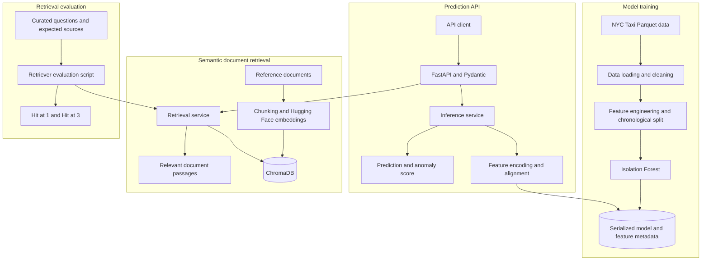

# FareAudit AI

**Anomaly detection and contextual investigation for NYC taxi trips.**

FareAudit AI is an end-to-end machine learning application that identifies unusual taxi fare patterns and supports further investigation through semantic document retrieval. It brings together **data engineering, unsupervised learning, API design, retrieval systems, automated testing, and container delivery** in a modular Python codebase.

The system is designed around a straightforward workflow: **prepare trip data → train an anomaly detector → serve predictions through an API → retrieve relevant context when needed**.

**Tech stack:** Python 3.11 · PyArrow · Pandas · NumPy · scikit-learn · FastAPI · Pydantic · LangChain · Hugging Face · ChromaDB · pytest · Docker · GitHub Actions · GitHub Container Registry

## Overview

Taxi fares are influenced by multiple interacting factors, including distance, pickup time, payment method, fare amount, and additional charges. A trip that looks ordinary along one dimension can be unusual when these attributes are considered together.

FareAudit AI addresses this problem with two complementary capabilities:

- **ML-based anomaly detection:** an Isolation Forest model identifies statistically unusual trip records and exposes its decisions through a structured REST API.
- **Contextual document retrieval:** an embedding-based search pipeline indexes reference material in ChromaDB and retrieves relevant passages for investigation.

The prediction and retrieval components are deliberately decoupled, allowing them to be developed, tested, and operated independently. **The current retrieval capability returns source passages; LLM-based answer generation is planned, not yet part of the implemented pipeline.**

## Key capabilities

| Area | Implementation |
| --- | --- |
| Data ingestion | Read and process NYC taxi trip data stored in Parquet format with PyArrow and Pandas |
| Feature engineering | Clean records, derive model inputs, encode payment methods, and preserve feature consistency between training and inference |
| Anomaly detection | Train and serialize an Isolation Forest model using scikit-learn |
| Model serving | Expose structured predictions and anomaly scores through FastAPI |
| Input validation | Enforce request contracts with Pydantic |
| Semantic retrieval | Generate Hugging Face embeddings, index passages in ChromaDB, and retrieve them with LangChain |
| Retrieval evaluation | Benchmark document retrieval with a manually curated question set and source-level Hit@K metrics |
| Automated tests | Run pytest checks through GitHub Actions on pushes and pull requests |
| Container delivery | Build Docker images and automatically publish commit-tagged images to GitHub Container Registry after successful CI checks on `main` |

## Architecture



### Design principles

**Training–serving consistency.** Inference reconstructs the features expected by the fitted model, including one-hot encoded payment types and the original feature order.

**Separation of concerns.** Input validation, feature preparation, model inference, and document retrieval have distinct responsibilities, keeping the system easier to maintain and test.

**Reproducible delivery.** The application is containerized, and the CI workflow builds and publishes Docker images only after automated checks pass on the `main` branch.

**Evidence-based retrieval improvements.** Retrieval changes are evaluated against a documented baseline, with a consistent question set and a freshly rebuilt index when chunking or embeddings change.

## Data pipeline and anomaly detection

The modeling workflow uses **NYC TLC Yellow Taxi data from January 2025**, supplied as Parquet files. PyArrow supports efficient access to columnar trip records, while Pandas and NumPy are used to prepare model inputs.

The pipeline performs data preparation, a chronological train/test split, categorical encoding, Isolation Forest training, and serialization of the resulting model artifact.

### Experiment snapshot

| Metric | Value |
| --- | ---: |
| Trips sampled | 100,000 |
| Records retained after cleaning | 99,999 |
| Training records | 79,999 |
| Test records | 20,000 |
| Model features | 10 |
| Test records flagged as anomalous | 369 |
| Share of test records flagged | 1.845% |

These figures describe the recorded experiment and the model's anomaly-flagging behavior. Isolation Forest produces an **unsupervised anomaly signal**, not a verified fraud classification or a fraud probability.

### Prediction contract

Trip requests are validated with Pydantic. Example input:

```json
{
  "trip_distance": 12.5,
  "fare_amount": 45,
  "tip_amount": 5,
  "total_amount": 55,
  "pickup_hour": 14,
  "payment_type": 1
}
```

Example response shape:

```json
{
  "prediction": -1,
  "is_anomaly": true,
  "anomaly_score": -0.08
}
```

*These values illustrate the API response format; they are not a computed prediction for the sample request.*

In scikit-learn's Isolation Forest, `-1` indicates an outlier and `1` indicates an inlier. The `anomaly_score` represents the model's decision-function output; values below zero are on the anomalous side of the threshold.

## Semantic document retrieval

The document-retrieval pipeline complements the anomaly detector with searchable reference material. It:

1. Loads Markdown reference documents from `knowledge/`.
2. Splits documents into chunks and preserves source-file metadata.
3. Generates embeddings using a Hugging Face sentence-transformer model (MiniLM in the current baseline).
4. Stores vector representations in a persistent **ChromaDB** collection.
5. Uses **LangChain** to retrieve relevant passages for a query.

The current retrieval endpoint exposes the retrieved content and sources for investigation. It does **not** yet generate natural-language answers with an LLM. An answer-generation layer with citations is planned.

### Current retrieval baseline

| Setting | Current value |
| --- | --- |
| Embedding model | Sentence Transformers / MiniLM |
| Vector database | ChromaDB (`fareaudit_knowledge`) |
| Retrieval | Vector similarity, top 3 chunks |
| Chunk size | 800 characters |
| Chunk overlap | 100 characters |
| Knowledge corpus | 3 Markdown files |
| Indexed chunks | 4 after a clean rebuild |

The knowledge corpus currently contains:

- `payment_types.md` — NYC taxi payment codes and their interpretation.
- `financial_fields.md` — definitions of fares, tips, totals, and trip distance.
- `investigation_rules.md` — **experimental project rules**, not official NYC TLC fraud rules.

These settings describe the **current baseline**, not permanently fixed design choices. Future experiments will compare chunking, embeddings, retrieval methods, and ranking strategies.

### Rebuild the knowledge index

Indexing is a separate development operation, similar to model training:

```bash
python -m scripts.index_knowledge
```

The current `index_documents()` implementation uses a **full collection reset** before indexing. Run this operation deliberately, preferably with the API stopped. It deletes the existing vectors in `fareaudit_knowledge` and recreates the index; it is **not** an incremental or zero-downtime production ingestion pipeline.

Rebuild the index whenever you change the reference documents, chunking parameters, or embedding configuration. Verify that the stored chunk count matches the count produced by the current document splitter. Future work will introduce stable document/chunk identifiers and incremental updates.

## Retriever evaluation

FareAudit AI includes an experimental retrieval benchmark in [`evaluate_retriever.py`](evaluate_retriever.py). The benchmark tests whether the Retriever can find information needed to answer questions about NYC taxi transactions and the project's investigation rules.

### Evaluation setup

- **Evaluation set:** 12 manually written questions based on the three indexed Markdown documents.
- **Reference labels:** one expected source file per question.
- **Retrieval depth:** top 3 chunks per query; Hit@1 is computed from the first of those three results.
- **Execution:** the real embedding model and ChromaDB collection are used, rather than mocked retrieval results.

Run the evaluation from the repository root:

```bash
python evaluate_retriever.py
```

### Baseline results

*Snapshot: November 2026. Refresh this table after each documented experimental run rather than treating these values as fixed benchmarks.*

| Metric | Result | Scope |
| --- | ---: | --- |
| **Hit@1** | **75%** (9/12) | 12 questions; expected source-file matching |
| **Hit@3** | **100%** (12/12) | 12 questions; expected source-file matching |
| **Precision@3** | **33.3%** | Manual, strict passage-level annotations on **3 selected questions** |
| **MRR** | **0.444** | Manual, strict passage-level annotations on the **same 3 questions** |

**Important interpretation:** Hit@K checks whether at least one retrieved chunk belongs to the expected **file**, not whether that chunk contains the answer. Precision@3 and MRR were calculated separately from manual relevance judgments on three questions whose expected file was not ranked first; **they are not full-dataset scores**. The manually evaluated sample is deliberately difficult and should not be generalized to all queries.

With only four indexed chunks, retrieving three chunks covers most of the corpus. The perfect Hit@3 therefore **does not demonstrate production-quality retrieval**.

### What the evaluation revealed

The first attempt to change chunk size left obsolete vectors in ChromaDB: **12 chunks remained indexed while the updated splitter produced only 4**. Consequently, irrelevant historical fragments sometimes appeared at the top of retrieval results.

A clean collection rebuild synchronized the stored vectors with the current chunking configuration. After the rebuild, the query **“What does `fare_amount` represent?”** retrieved `financial_fields.md` in first position. However, the **overall source-level Hit@1 remained 75%** across the 12-question benchmark; changing the ranking on one query did not improve the aggregate score.

Because the earlier index contained stale chunks, this comparison does **not isolate the effect of chunk size**. Future controlled experiments must rebuild their indexes consistently before comparing configurations.

### Planned retrieval experiments

The project will evolve through measurable experiments rather than assuming that one technique is always better:

| Experiment | What will change | What will be measured | Status |
| --- | --- | --- | --- |
| Larger corpus | Add verified reference documents and more varied questions | Hit@K, ranking quality, coverage | Planned |
| Passage-level labels | Identify relevant chunk IDs/content rather than only filenames | Precision@K, Recall@K, MRR, potentially nDCG | Planned |
| Chunking comparison | Compare chunk sizes, overlaps, and Markdown-aware splitting | Retrieval quality and context usefulness | Planned |
| Embedding comparison | Compare embedding models suited to the query language | Ranking quality and retrieval latency | Planned |
| Hybrid search | Combine vector retrieval with lexical keyword matching (e.g., BM25) | Accuracy on exact field names and paraphrases | Planned |
| Reranking | Reorder candidate passages using a reranker | Precision@K and MRR | Planned |
| No-answer queries | Add questions unsupported by the corpus | False retrieval confidence and abstention behavior | Planned |
| LLM answer generation | Compose grounded answers from retrieved evidence | Answer correctness, faithfulness, source attribution | Planned |

For meaningful comparisons, keep the **same evaluation questions, relevance judgments, corpus version, and retrieval depth** for each experiment. Record the experiment configuration and results; change one major variable at a time wherever possible.

### Evaluation limitations

- Only three short Markdown source documents and four stored chunks.
- Twelve questions, mainly derived directly from reference text.
- Source-file labels can conceal missing or irrelevant passages.
- The three manually assessed difficult cases are not representative of the full dataset.
- No evaluation of LLM-generated answers yet, because the LLM generation step has not been implemented.
- No systematic measurement of latency, retrieval failure modes, or unsupported questions yet.

The current metrics are an **exploratory engineering baseline**, not a production performance claim.

Detailed methodology and follow-up experiments: [`docs/rag_evaluation.md`](docs/rag_evaluation.md).

## Repository structure

```text
FareAudit-ai/
├── .github/
│   └── workflows/
│       └── ci.yml                 # Tests and Docker image publishing
├── src/
│   └── fareaudit/
│       ├── schemas.py             # Pydantic request models
│       ├── inference.py           # Prediction and feature preparation
│       ├── document_loader.py     # Load and split documents
│       ├── embeddings.py          # Embedding model configuration
│       ├── vector_store.py        # ChromaDB and indexing logic
│       ├── retriever.py           # Semantic retrieval configuration
│       ├── services/              # Application service layer
│       └── routers/               # FastAPI route handlers
├── scripts/
│   └── index_knowledge.py         # Manual knowledge-index rebuild
├── docs/
│   └── rag_evaluation.md          # Detailed retrieval evaluation report
├── tests/                         # Automated Python tests
├── knowledge/                     # Source Markdown documents
├── models/                        # Serialized ML artifacts
├── chroma_db/                     # Persistent local vector index
├── data/                          # Input data
├── evaluate_retriever.py          # Retrieval evaluation entry point
├── main.py                        # FastAPI entry point
├── train_model.py                 # Model training entry point
├── requirements.txt               # Python dependencies
├── Dockerfile                     # Container image definition
└── .dockerignore                  # Docker build-context exclusions
```

*This tree highlights the main modules and expected documentation file. Create `docs/rag_evaluation.md` if you have not saved the detailed report yet; consult the repository for the complete structure.*

## Getting started

### Prerequisites

- Python 3.11
- `pip` and Python virtual environments
- Docker for containerized execution
- The dataset and model artifacts required for the workflow being executed

### Install dependencies

From the repository root:

```bash
python3.11 -m venv .venv
source .venv/bin/activate
python -m pip install --upgrade pip
python -m pip install -r requirements.txt
```

### Train the model

Place the source Parquet data at the path configured by the training script. The initial workflow uses `data/raw/yellow_tripdata_2025-01.parquet`.

```bash
python train_model.py
```

The trained model is expected at `models/isolation_forest.joblib`. Ensure that the required model artifact is available when running inference.

### Run the API locally

```bash
uvicorn main:app --host 127.0.0.1 --port 8000 --reload
```

Open **http://127.0.0.1:8000/docs** to explore the available FastAPI routes and request schemas.

### Build and run with Docker

```bash
docker build -t fareaudit:1.0 .

docker run --rm --name fareaudit-api \
  -p 127.0.0.1:8000:8000 \
  fareaudit:1.0
```

The Docker image packages the application and its installed dependencies. Ensure that any model artifacts or persistent retrieval data required at runtime are included in the image or made available through appropriate mounts.

## Testing and quality engineering

FareAudit AI uses **pytest** to validate the application's behavior. Unit tests cover input validation and inference contracts, with `Mock` and `monkeypatch` allowing model-dependent logic to be tested independently of model loading or the actual estimator.

Run the test suite locally:

```bash
python -m pytest tests/ -v
```

This approach helps keep tests fast, focused, and independent of external model artifacts where appropriate. The Retriever benchmark is a separate **integration/evaluation run** that loads real embeddings and reads the real local vector index. It is **not** equivalent to a mocked unit test and may be kept outside the fast CI suite until a reproducible evaluation corpus/index fixture is available.

## CI and automated container delivery

The GitHub Actions workflow is defined in [`.github/workflows/ci.yml`](.github/workflows/ci.yml).

It implements a dependency-aware delivery process:


**CI checks:** pushes and pull requests trigger the `tests` job, which installs project dependencies and runs pytest on a GitHub-hosted Ubuntu runner.

**Container publishing:** on successful pushes to `main`, the `build-and-push` job builds the Docker image and publishes it to **GitHub Container Registry (`ghcr.io`)**. The image is tagged using both `latest` and the Git commit SHA, providing a direct link between the published artifact and its source revision.

**Release safety:** the publication job declares `needs: tests`, so it does not run when the test job fails. The workflow automates image delivery; deployment to a runtime environment is a separate operation.

## Engineering choices

| Choice | Engineering rationale |
| --- | --- |
| **Isolation Forest** | Detects unusual multivariate patterns without requiring labeled anomaly examples |
| **Chronological evaluation split** | Preserves temporal ordering between training and evaluation data |
| **Model-aware feature alignment** | Prevents column-order and categorical-encoding mismatches during inference |
| **Pydantic** | Makes the inference input contract explicit and validates requests before model execution |
| **Modular inference and retrieval** | Keeps model predictions and document search independently testable |
| **Versioned retrieval evaluation** | Preserves a baseline and makes changes in retrieval quality measurable |
| **Explicit index rebuilds in development** | Prevents stale chunks from contaminating search results during experiments |
| **Docker** | Packages application dependencies and runtime configuration in a portable image |
| **GitHub Actions + GHCR** | Couples automated tests to traceable, commit-tagged container publication |

## Dataset

The initial modeling workflow is based on the **NYC Taxi & Limousine Commission (TLC) Yellow Taxi Trip Records**, January 2025. The dataset is used for fare-pattern analysis and unsupervised anomaly detection.

Source: [NYC TLC Trip Record Data](https://www.nyc.gov/site/tlc/about/tlc-trip-record-data.page).

---

**FareAudit AI** · Machine Learning Engineering · Anomaly Detection · FastAPI · Retrieval · MLOps