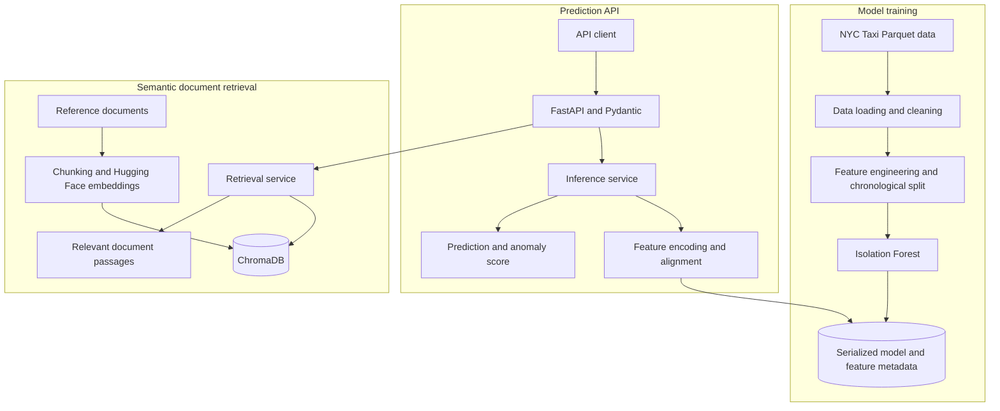

# FareAudit AI

**Anomaly detection and contextual investigation for NYC taxi trips.**

FareAudit AI is an end-to-end machine learning application that identifies unusual taxi fare patterns and supports further investigation through semantic document retrieval. It brings together **data engineering, unsupervised learning, API design, retrieval systems, automated testing, and container delivery** in a modular Python codebase.

The system is designed around a straightforward workflow: **prepare trip data → train an anomaly detector → serve predictions through an API → retrieve relevant context when needed**.

**Tech stack:** Python 3.11 · PyArrow · Pandas · NumPy · scikit-learn · FastAPI · Pydantic · LangChain · Hugging Face · ChromaDB · pytest · Docker · GitHub Actions · GitHub Container Registry

## Overview

Taxi fares are influenced by multiple interacting factors, including distance, pickup time, payment method, fare amount, and additional charges. A trip that looks ordinary along one dimension can be unusual when these attributes are considered together.

FareAudit AI addresses this problem with two complementary capabilities:

- **ML-based anomaly detection:** an Isolation Forest model identifies statistically unusual trip records and exposes its decisions through a structured REST API.
- **Contextual document retrieval:** an embedding-based search pipeline indexes reference material in ChromaDB and retrieves relevant passages for investigation.

The prediction and retrieval components are deliberately decoupled, allowing them to be developed, tested, and operated independently.

## Key capabilities

| Area | Implementation |
| --- | --- |
| Data ingestion | Read and process NYC taxi trip data stored in Parquet format with PyArrow and Pandas |
| Feature engineering | Clean records, derive model inputs, encode payment methods, and preserve feature consistency between training and inference |
| Anomaly detection | Train and serialize an Isolation Forest model using scikit-learn |
| Model serving | Expose structured predictions and anomaly scores through FastAPI |
| Input validation | Enforce request contracts with Pydantic |
| Semantic retrieval | Generate Hugging Face embeddings, index passages in ChromaDB, and retrieve them with LangChain |
| Automated tests | Run pytest checks through GitHub Actions on pushes and pull requests |
| Container delivery | Build Docker images and automatically publish commit-tagged images to GitHub Container Registry after successful CI checks on `main` |

## Architecture



### Design principles

**Training–serving consistency.** Inference reconstructs the features expected by the fitted model, including one-hot encoded payment types and the original feature order.

**Separation of concerns.** Input validation, feature preparation, model inference, and document retrieval have distinct responsibilities, keeping the system easier to maintain and test.

**Reproducible delivery.** The application is containerized, and the CI workflow builds and publishes Docker images only after automated checks pass on the `main` branch.

## Data pipeline and anomaly detection

The modeling workflow uses **NYC TLC Yellow Taxi data from January 2025**, supplied as Parquet files. PyArrow supports efficient access to columnar trip records, while Pandas and NumPy are used to prepare model inputs.

The pipeline performs data preparation, a chronological train/test split, categorical encoding, Isolation Forest training, and serialization of the resulting model artifact.

### Experiment snapshot

| Metric | Value |
| --- | ---: |
| Trips sampled | 100,000 |
| Records retained after cleaning | 99,999 |
| Training records | 79,999 |
| Test records | 20,000 |
| Model features | 10 |
| Test records flagged as anomalous | 369 |
| Share of test records flagged | 1.845% |

These figures describe the recorded experiment and the model's anomaly-flagging behavior. Isolation Forest produces an **unsupervised anomaly signal**, not a verified fraud classification or a fraud probability.

### Prediction contract

Trip requests are validated with Pydantic. Example input:

```json
{
  "trip_distance": 12.5,
  "fare_amount": 45,
  "tip_amount": 5,
  "total_amount": 55,
  "pickup_hour": 14,
  "payment_type": 1
}
```

Example response shape:

```json
{
  "prediction": -1,
  "is_anomaly": true,
  "anomaly_score": -0.08
}
```

*These values illustrate the API response format; they are not a computed prediction for the sample request.*

In scikit-learn's Isolation Forest, `-1` indicates an outlier and `1` indicates an inlier. The `anomaly_score` represents the model's decision-function output; values below zero are on the anomalous side of the threshold.

## Semantic document retrieval

The document-retrieval pipeline complements the anomaly detector with searchable reference material. It:

1. Loads and splits source documents into passages.
2. Generates embeddings using a Hugging Face sentence-transformer model.
3. Stores vector representations in **ChromaDB**.
4. Retrieves passages relevant to a query using **LangChain**.

This component supports context discovery alongside model predictions without coupling the retrieval pipeline to anomaly scoring.

## Repository structure

```text
FareAudit-ai/
├── .github/
│   └── workflows/
│       └── ci.yml             # Tests and Docker image publishing
├── src/
│   └── fareaudit/
│       ├── schemas.py         # Pydantic request models
│       └── inference.py       # Prediction and feature preparation integration
├── tests/                     # Automated Python tests
├── models/                    # Model artifacts
├── knowledge/                 # Documents used for retrieval
├── chroma_db/                 # Local vector database
├── data/                      # Input data
├── main.py                    # FastAPI entry point
├── train_model.py             # Model training entry point
├── requirements.txt           # Python dependencies
├── Dockerfile                 # Container image definition
└── .dockerignore              # Docker build-context exclusions
```

*The `src/fareaudit/` directory is shown with representative modules; consult the repository for its full contents.*

## Getting started

### Prerequisites

- Python 3.11
- `pip` and Python virtual environments
- Docker for containerized execution
- The dataset and model artifacts required for the workflow being executed

### Install dependencies

From the repository root:

```bash
python3.11 -m venv .venv
source .venv/bin/activate
python -m pip install --upgrade pip
python -m pip install -r requirements.txt
```

### Train the model

Place the source Parquet data at the path configured by the training script. The initial workflow uses `data/raw/yellow_tripdata_2025-01.parquet`.

```bash
python train_model.py
```

The trained model is expected at `models/isolation_forest.joblib`. Ensure that the required model artifact is available when running inference.

### Run the API locally

```bash
uvicorn main:app --host 127.0.0.1 --port 8000 --reload
```

Open **http://127.0.0.1:8000/docs** to explore the available FastAPI routes and request schemas.

### Build and run with Docker

```bash
docker build -t fareaudit:1.0 .

docker run --rm --name fareaudit-api \
  -p 127.0.0.1:8000:8000 \
  fareaudit:1.0
```

The Docker image packages the application and its installed dependencies. Ensure that any model artifacts or persistent retrieval data required at runtime are included in the image or made available through appropriate mounts.

## Testing and quality engineering

FareAudit AI uses **pytest** to validate the application's behavior. Unit tests cover input validation and inference contracts, with `Mock` and `monkeypatch` allowing model-dependent logic to be tested independently of model loading or the actual estimator.

Run the test suite locally:

```bash
python -m pytest tests/ -v
```

This approach helps keep tests fast, focused, and independent of external model artifacts where appropriate.

## CI and automated container delivery

The GitHub Actions workflow is defined in [`.github/workflows/ci.yml`](.github/workflows/ci.yml).

It implements a dependency-aware delivery process:


**CI checks:** pushes and pull requests trigger the `tests` job, which installs project dependencies and runs pytest on a GitHub-hosted Ubuntu runner.

**Container publishing:** on successful pushes to `main`, the `build-and-push` job builds the Docker image and publishes it to **GitHub Container Registry (`ghcr.io`)**. The image is tagged using both `latest` and the Git commit SHA, providing a direct link between the published artifact and its source revision.

**Release safety:** the publication job declares `needs: tests`, so it does not run when the test job fails. The workflow automates image delivery; deployment to a runtime environment is a separate operation.

## Engineering choices

| Choice | Engineering rationale |
| --- | --- |
| **Isolation Forest** | Detects unusual multivariate patterns without requiring labeled anomaly examples |
| **Chronological evaluation split** | Preserves temporal ordering between training and evaluation data |
| **Model-aware feature alignment** | Prevents column-order and categorical-encoding mismatches during inference |
| **Pydantic** | Makes the inference input contract explicit and validates requests before model execution |
| **Modular inference and retrieval** | Keeps model predictions and document search independently testable |
| **Docker** | Packages application dependencies and runtime configuration in a portable image |
| **GitHub Actions + GHCR** | Couples automated tests to traceable, commit-tagged container publication |

## Dataset

The initial modeling workflow is based on the **NYC Taxi & Limousine Commission (TLC) Yellow Taxi Trip Records**, January 2025. The dataset is used for fare-pattern analysis and unsupervised anomaly detection.

Source: [NYC TLC Trip Record Data](https://www.nyc.gov/site/tlc/about/tlc-trip-record-data.page).

---

**FareAudit AI** · Machine Learning Engineering · Anomaly Detection · FastAPI · Retrieval · MLOps